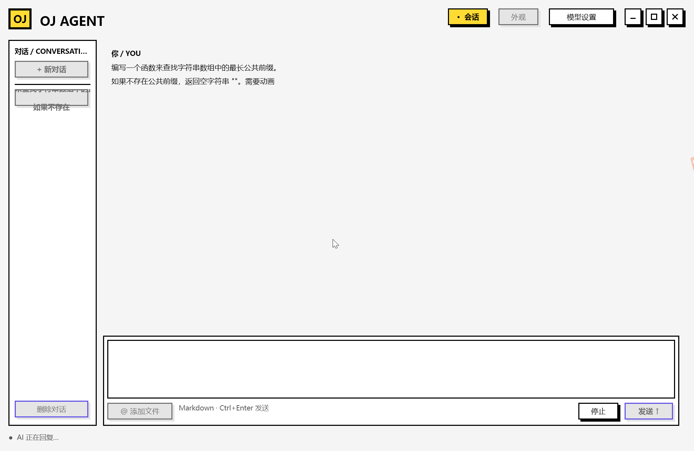

# OJ Agent

[中文](README.zh-CN.md)
## Preview

OJ Agent is a Rust desktop chat workspace for discussing code and opening verified algorithm animations.


## Usage

Requires Rust 1.97.1+ and platform C/C++ build tools.

```sh
cargo run
```

Open **模型设置**, configure OpenAI, DeepSeek or a compatible endpoint, then chat. Use `@` to attach text/source files. AI decides whether an animation helps; click its message link to open the animation **inside the app**.

## Features

- Persistent conversations with Markdown, code blocks, tables and attachment snapshots.
- Optional AI-triggered code verification and animation; no algorithm/sample forms.
- Portable JavaScript VM with time, memory and stack limits; no host file/network/process APIs or Docker.
- Normal, boundary and adversarial checks; separate animation timelines for each case.
- Slint desktop UI, Skia playback, GIF/JSON export, and saved model and appearance settings.
- Rig model providers, validated IR, SQLite artifacts, cancellation and bounded tool rounds.

The portable sandbox executes JavaScript. Checks of AI-translated Python/C++/Rust algorithms are clearly labeled; they do not execute or prove the original programs. Passing supplied tests is not exhaustive correctness verification.

## Documentation

[Chat and sandbox](docs/CHAT.md) · [Usage](docs/USAGE.md) · [Appearance](docs/STYLE.md) · [Renderer](docs/RENDERER.md) · [Architecture](ARCHITECTURE.md) · [IR](IR.md) · [Tools](TOOL.md) · [Sessions](SESSIONS.md) · [Errors](EXCEPTON.md) · [Design](DESIGN.md) · [License](LICENSE.md)

```sh
cargo fmt --check
cargo check
cargo test --workspace
cargo clippy --workspace --all-targets -- -D warnings
```
